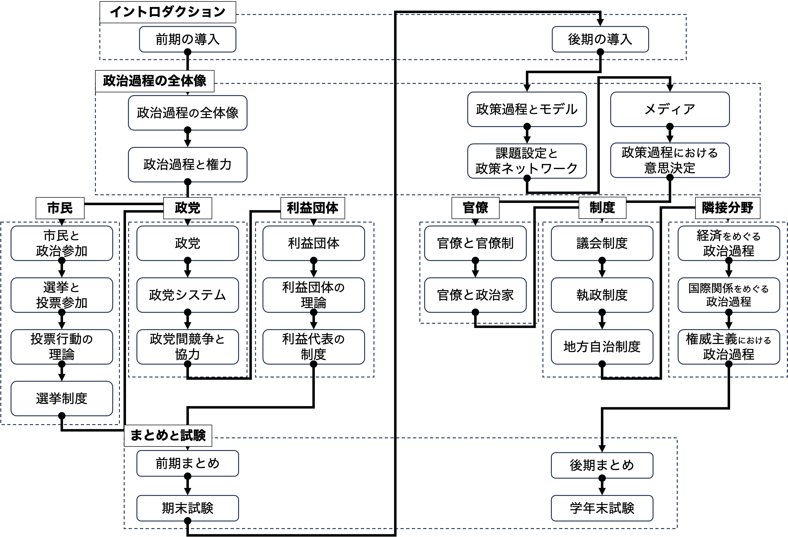
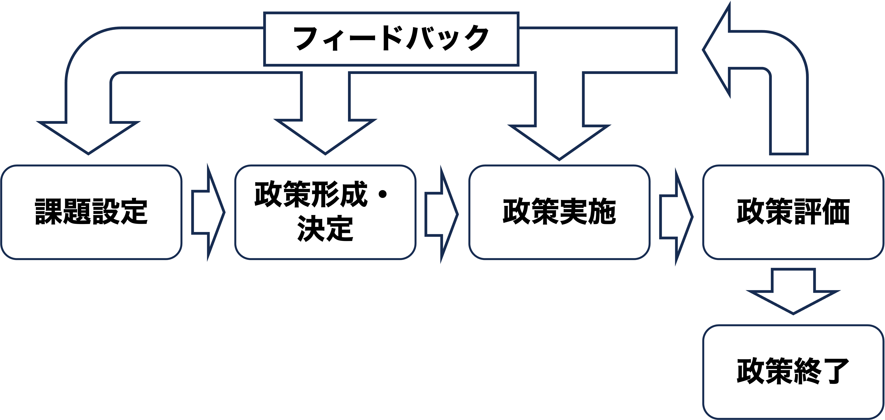

## 出席登録をお願いします

## 演習の追加募集
- まだ枠が十分あるので、追加募集
  - 11/12にKONECOでアナウンス
  - 11/20〜12/1が応募期間（Google Form）
- Google Formと成績表提出（面接は行わない）
- 詳細はKONECO参照
- 本格的にRを学び、政治現象を計量的に研究

## 今日の目次

1. はじめに
1. 政策過程と官僚
1. 官僚の行動原理
1. 官僚の公益観
1. 官僚制
1. まとめ

# はじめに
::: {.notes}
目標15分
:::
## 先週のRPより (1/3)
> 限定合理性のことを、ピンチになった時に、普段では思いつかない解決策や回避策が思いつくというイメージなのかなと解釈した。

::: {.fragment}
> 理想を追う合理的包括よりも、参加者の同意重視で限定的に進める連続的限定比較の方が現実の仕事や意思決定に近いと思った。また、実際の政策決定現場ではどちらのやり方が主流なのか気になった。

:::

::: {.notes}
注意喚起（WebClassのメッセージ参照）

- 当該回と関係のないことを書いている
   - おそらく出席せずに授業資料だけを見て書いている
   - 例えば先週は意思決定の話をしたのに、今日学ぶ官僚の話を書いている
- 今後同様の事例があった場合にはRPは提出していないものとみなす

限定合理性→ピンチになった時に普段思いつかないことが思いつくというのは微妙に違う

- この書き方だと「ピンチの時にこそ完全合理性が発揮できる」という感じになりそうだが…。
- 人間は情報処理能力などのさまざまな限界の中で合理性を発揮できるに過ぎないということ
   - 人間は完全に不合理というわけではない→制約に直面しながら最善はつくす
   - とはいえ、やはり制約は存在して、完全に合理的であることは無理

合理的包括的意思決定と連続的限定比較

- 実際の政策決定現場では後者の方が主流
   - 例：予算編成、警察の検挙目標…

:::

## 先週のRPより (2/3)
> 合理的行為者モデルと政府内政治モデルについては理解することができたが、組織課程モデルについては理解するのが難しかった。

::: {.fragment .fade-in}
> アリソンの3モデルはキューバ危機で何がどう違うのか、特に政府内政治モデルが理解しきれなかった。

:::

::: {.fragment .fade-in}
> 最後のクイズで組織過程モデルか政府内政治モデルかの解説が分からなかった。

:::

::: {.notes}
組織過程モデル

- 政府は人間の集合体である組織であるから、直ちに個人のように行動しない
- 異なった人間を動かすためには、マニュアル（標準作業手続き）が必要
- マニュアルにしたがった結果、カモフラージュなしにミサイルを置くような一見不合理な行動をすることがある

政府内政治モデル

- 政府の中にはお偉いさんたちがいて、権力闘争をする
    - 予算が欲しい、縄張りを維持したい、手柄が欲しい…
- 自分の都合で異なった政策を提示し、争う
    - 空爆で存在意義を示したい空軍と外交で手柄を上げたい国務省
    - 日本の陸軍と海軍→方針の違いや予算争い

クイズの解説

- 踊る大捜査線
   - すでに現場の捜査員（青島くん）が犯人を見つけた→そのまま逮捕するのが合理的
   - しかし警察上層部が止めて、言い争っている（「うちの捜査員を行かせる」）
       - 現場ではなく自分の部署が逮捕できれば自分の手柄になる
       - これはまさに政府内政治モデルの例→自分の都合で政策を争う
- フジテレビ
   - 疑惑を晴らし説明責任を果たすためにはオープンで会見した方が合理的
   - しかし実際には動画撮影禁止の会見が開かれた
      - 報道されたのは静止画だけの紙芝居状態
   - 普段行っている月一回の定例記者会見を前倒しする形で行った
      - 定例だからマニュアルがしっかりしている
      - 1から記者会見のやり方を考え直すよりは合理的
      - これはまさに組織過程モデルの例→マニュアルに従って裏目に出た

:::

## 先週のRPより (3/3)
> キューバ危機において、政府内政治モデルでは、アメリカは、空軍と国務省の争いに、海上封鎖という決断をとったとなるが、妥協の産物として生まれた結果は、閉鎖ということは国務省に傾いたということなのですか。

::: {.notes}
空軍と国務省の間をとったといった方がいい

- 空軍→再強硬派として空爆…断固とした態度を見せるべき
- 国務省→外交的解決…危機をエスカレートさせて戦争に行くことは避けるべき
- 海上封鎖…断固とした態度は見せられるが、直接の武力行使ではないので空爆よりは危険は少ない

:::

## 本日の目的と到達目標
#### 目的
政策過程で重要な役割を官僚と官僚制を考察する。政治システムにおける官僚・官僚制の位置付けを議論した後、官僚の行動原理を説明するモデルや官僚の公益観を学ぶ。さらに官僚の効率性について対立する見方を紹介する。

::: {.fragment .fade-in}
#### 到達目標
1. 政策過程において官僚が果たす役割を議論できる。
1. 予算極大化モデルと組織形整モデルの違いを説明できる。
1. シューバートによる官僚の公益観の3類型を説明できる。
1. ヴェーバーとマートンの議論をもとに、官僚制の効率性について説明できる。

:::

## 本日の授業の位置付け

# 政策過程と官僚
::: {.notes}
ここまで15分

目標10分
:::

## 復習：政策過程
{width=80%}

::: {.fragment .fade-in}
Q.政策過程で官僚はどのような役割を果たしている？（[WebClassチャット](https://webclass.komazawa-u.ac.jp/webclass/login.php?id=a7d6002902f48ca2262c9488a59965fe)）

:::

## 官僚 (bureaucrat)
役人。官吏。特に、政策決定に影響力をもつ中・上級の公務員。 （[デジタル大辞泉](https://www.weblio.jp/content/%E5%AE%98%E5%83%9A?dictCode=SGKDJ)）

::: {.incremental}
- 第一には、政治家が決定した政策を**実施**
- しかし**政策形成・決定**にも影響
   - 例：日本の法案作成…官僚が立案した内閣提出法案が大多数

:::

::: {.fragment .fade-in}
#### プリンシパル＝エージェント関係（次回）
**本人**ができないことを**代理人**に委任する関係

::: {.incremental}
- 本人＝政治家→代理人＝官僚
- 行政が関与する領域が増えるにつれて、官僚の専門知識はますます重要に  

:::

:::

# 官僚の行動原理
::: {.notes}
ここまで25分

目標20分
:::

## 復習：合理的選択理論
::: {.incremental}
- 経済学における基本的な考え
- アクターは効用を最大化するべく行動と仮定

:::

::: {.fragment .fade-in}
官僚も**自己利益**を追求する存在と捉えることが可能

::: {.incremental}
- 権力、収入、威信…
- 二つのモデル：予算極大化モデルvs.組織形整モデル

:::
:::

## 予算極大化モデル
#### budget-maximizing model
官僚は自分の属する行政機関の**予算を最大化**させようと行動する

::: {.incremental}
- 予算→昇進機会、待遇改善、社会からの注目、有為な人材、大きな影響力…

:::

::: {.fragment .fade-in}
批判：あまりにも単純すぎる

::: {.incremental}
- 必ずしも自己利益だけではない（→公益観）
- 予算削減＝不利益というわけではない

:::
:::

## 組織形整モデル
#### bureau-shaping model
官僚が予算に対して持つ選好は地位によって異なり、予算極大化が直ちに実現されるわけではない

::: {.incremental}
- **エリート官僚**…予算よりは昇進の機会→自分にとって望ましい組織の形を作りたいし、予算削減に協力することで出世する機会も
- **非エリート官僚**…昇進の機会なし→予算極大化を選好、しかしフリーライダー問題にも直面

:::

## アンケート
あなたは予算極大化モデルと組織形整モデルどちらにより説得力があると思いますか？

[WebClassアンケート](https://webclass.komazawa-u.ac.jp/webclass/login.php?id=0481df5531f9b0e1cc73e8a32f170f2e&page=1)

{.r-stretch}

# 官僚の公益観
::: {.notes}
ここまで45分

休憩5分

目標20分
:::

## 官僚の公益観
官僚は自己利益だけでなく「公益への奉仕」という義務感でも行動

::: {.fragment .fade-in}
**シューバート**の3類型

|              | 公益観         | 官僚の役割     | 
| ------------ | -------------- | -------------- | 
| **合理主義** | 政治が決定     | 忠実な執行者   | 
| **理想主義** | 官僚が定義     | 公益の実現者   | 
| **現実主義** | 利害調整の結果 | 調整者・執行者 | 

:::

## 質問

合理主義・理想主義・現実主義という3つの公益像のうち、あなたはどの像を持った官僚が最も望ましいと思いますか。

理由も含めてて[チャット](https://webclass.komazawa-u.ac.jp/webclass/login.php?id=a7d6002902f48ca2262c9488a59965fe)に書き込んでください

{.r-stretch}

## 日本の官僚のタイプと変遷
日本の官僚は公益観に応じて3つのタイプが存在

::: {.incremental}
- **国士型官僚**…理想主義的な官僚
   - 60年代まで主流
   - Cf. 城山三郎『[官僚たちの夏](https://www.shinchosha.co.jp/book/113311/)』
- **調整型官僚**…現実主義的な官僚
   - 70年代以降に登場
   - 族議員や利益団体の登場・活発化に対応
- **吏員型官僚**…合理主義的な官僚
   - 80年代以降に登場
   - 自民党優位の確立と社会の成熟を背景

:::

# 官僚制
::: {.notes}
ここまで70分（01:10:00）

目標15分
:::
## アンケート
あなたは「官僚制」という言葉にポジティブあるいはネガティブどちらの印象を抱きますか。

[WebClassアンケート](https://webclass.komazawa-u.ac.jp/webclass/login.php?id=2e9985af4eed1a7656c96bacb035f6d2&page=1)で回答

{.r-stretch}

## マックス・ヴェーバー
::: {.columns}
::: {.column width=70%}
官僚制は社会の近代化にとって**必要不可欠な合理的な存在**と主張

::: {.incremental}
- 構成要素：規則による規律、明確な権限・ヒエラルキー、公私分離、文書主義、資格任用制、専業制
- 特徴：統一的な意思決定、公平中立で予測可能な対応、強い持続性

:::
:::

::: {.column width=30%}

:::

:::

## ロバート・マートン
::: {.columns}
::: {.column width=70%}
官僚制は**逆機能**をもたらし不効率になると指摘

::: {.incremental}
- **法規万能主義**…法律・規則を絶対視し自己目的化
- **繁文縟礼**…規則が必要以上に細かくなる
- **セクショナリズム**…縄張り争いと責任の押し付け合い
- **権威主義**…上位者が下位者を支配

:::
:::

::: {.column width=30%}

:::

:::

# まとめ
::: {.notes}
ここまで85分（01:25:00）

目標5分
:::
## 本日の目的と到達目標
#### 目的
政策過程で重要な役割を官僚と官僚制を考察する。政治システムにおける官僚・官僚制の位置付けを議論した後、官僚の行動原理を説明するモデルや官僚の公益観を学ぶ。さらに官僚の効率性について対立する見方を紹介する。

::: {.fragment .fade-in}
#### 到達目標
1. 政策過程において官僚が果たす役割を議論できる。
1. 予算極大化モデルと組織形整モデルの違いを説明できる。
1. シューバートによる官僚の公益観の3類型を説明できる。
1. ヴェーバーとマートンの議論をもとに、官僚制の効率性について説明できる。

:::

## 次回までに
#### 事後学習

 - 授業資料を見直し、目標到達をセルフチェック
 - WebClass上でのリアクションペーパー入力（日曜日まで）
 
#### 事前学習

 - 【事前】参考書（伊藤ほか10章）、教科書（IX-6）を読む。
