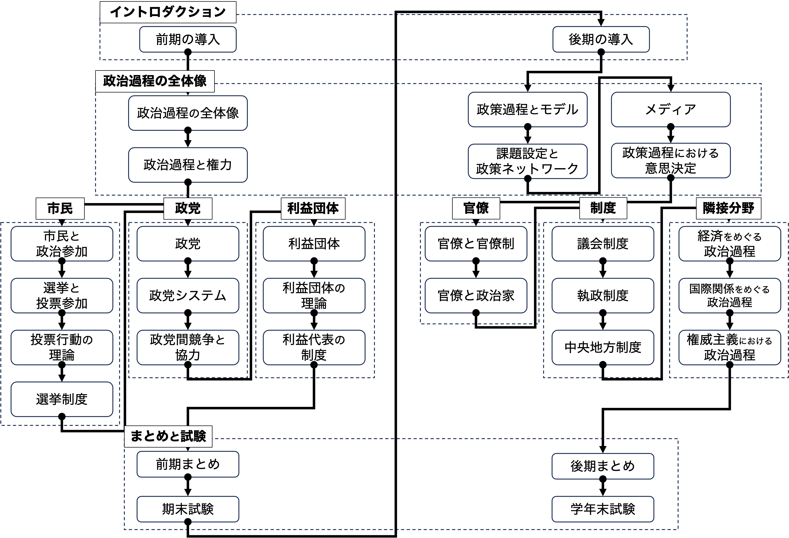

## 出席登録をお願いします

## 演習の追加募集
- まだ枠が十分あるので、追加募集
  - 11/12にKONECOでアナウンス
  - 11/20〜12/1が応募期間（Google Form）
- Google Formと成績表提出（面接は行わない）
- 詳細はKONECO参照
- 本格的にRを学び、政治現象を計量的に研究

## 今日の目次

1. はじめに
1. 執政制度
1. 執政制度と政治体制
1. 民主主義の多様性
1. 日本の首相のリーダーシップ
1. まとめ

# はじめに
## 先週のRPより
TBD

## 本日の目的と到達目標
#### 目的
執政リーダーをめぐる制度である執政制度について考察する。まず大まかな分類である議院内閣制・大統領制を学び、両者の特徴の違いを理解する。次に執政制度が政治体制の安定性にどのような影響をもたらすのか、政治学で繰り広げられてきた論争を概観する。さらに議院内閣制の多様性に注目し、関連するレイプハルトの議論を紹介する。最後に日本の首相のリーダーシップも合わせて検討する。

::: {.fragment .fade-in}
#### 到達目標
1. 議院内閣制と大統領制の違いを説明できる。
1. 執政制度が政治体制に与える影響をめぐる論争を説明できる。
1. 議院内閣制の多様性について、レイプハルトの議論における多数決型とコンセンサス型をそれぞれ説明できる。
1. 日本の首相のリーダーシップが90年代以降どのように変化したのか、その背景とともに説明できる。

:::

## 本日の授業の位置付け

# 執政制度
## クイズ
世界各国の行政府のあり方は、大きく議院内閣制・大統領制・半大統領制の3つに分けられます。以下それぞれの国はどれに分類されるでしょうか。（[WebClassで回答](https://webclass.komazawa-u.ac.jp/webclass/login.php?id=b357d903d096f099ddc0ab051613029f&page=1)）

- 日本
- アメリカ
- イギリス
- ドイツ
- フランス
- 韓国

## 執政制度
**執政府**（行政府）のリーダーである**執政リーダー**を選出し、立法府（議会）など他の国家機関との関係を決めるルールの総体

::: {.incremental}
 - **議院内閣制**
 - **大統領制**
 - **半大統領制**

:::

## 議院内閣制
#### parliamentary system
執政リーダー（首相）が議会[^parliament]から選ばれるシステム

::: {.incremental}
- 例：日本、イギリス、ドイツ、イタリア
   - 特に西欧諸国に多い
- 権力の「**融合**」が特徴
   - 多くは議会多数派の党首が首相に就任
   - 首相のもとに執政権と立法権が集中

:::

[^parliament]: 二院制の場合は特に下院

## 大統領制
#### presidential system
国民から直接選出される議会と執政リーダー（大統領）が併存するシステム

::: {.incremental}
- 例：アメリカ、韓国[^korea]、ブラジル
   - 特にラテンアメリカ諸国に多い
- 権力の「**分離**」が特徴
   - 大統領は固定任期で、議会から解任されないし議会の解散もできない
   - 議会多数派と大統領所属党が異なる**分割政府**が起こりやすい
       - 例：2026年中間選挙後のアメリカ

:::
[^korea]: 韓国には首相がいるが権限は小さいので半大統領制でなく（純粋）大統領制として扱われることが多い

## 半大統領制
#### semi-presidential system
国民から直接選ばれる大統領と議会多数派の信任に依拠する首相が執政権を分有するシステム

::: {.incremental}
- 例：フランス、台湾、ロシア
   - 特に旧共産圏の国に多い
- 議院内閣制や大統領制よりも複雑な権力関係
   - 議会多数派と大統領が一致→権力の融合
   - 議会多数派と大統領が不一致→違う党派の首相との「**共存**（cohabitation）」

:::

# 執政制度と政治体制
## 質問
議院内閣制と大統領制とでは、どちらが民主主義にとって望ましいシステムだと思いますか。

理由も含めて書き込んでみてください。

[WebClassチャット](https://webclass.komazawa-u.ac.jp/webclass/login.php?id=b8912946e9737ba7e785aee5bcf52905)

## 執政制度と政治体制
議院内閣制と大統領制、どちらが民主主義をもたらすのか？

::: {.incremental}
- 80年代以降の「**民主化の第3の波**」
   - 各国の軍事政権や東欧の共産主義体制が崩壊
   - 異なった政治体制
       - 議院内閣制の欧州（ポルトガル、スペイン、ギリシャ）
       - 大統領制のラテンアメリカ（ブラジル、アルゼンチンなど）

:::

## フアン・リンスの大統領制批判
::: {.columns}
::: {.column width=75%}
議院内閣制よりも大統領制は民主主義の定着に不利である[^linz1990]

::: {.incremental}
- 議会と大統領の併存…党派対立の可能性
- 大統領の固定任期…対立の際に不信任が不能で事態を打開できない→軍部介入の口実
- ゼロサム的な大統領選挙…勝者が大統領という独任制の役職を独占
- ポピュリズム的傾向…直接選挙なので大衆煽動をしがち
- 実証研究：1973-89年でクーデター発生率は議院内閣制で18%vs.大統領制で40%（Stepan and Skatch 1994）

:::

:::

::: {.column width=25%}

:::

:::

[^linz1990]:  Linz, J.J.J. (1990). The Perils of Presidentialism. *Journal of Democracy 1*(1), 51-69.

## 大統領制擁護論
大統領制は議院内閣制と比べて民主主義に不利というわけではない

::: {.incremental}
- 大統領の直接選挙はアカウンタビリティをもたらす
- 議会と大統領の併存は抑制と均衡をもたらす
- 議院内閣制は内閣の不安定性をもたらす
- 議院内閣制の方がゼロサム的な選挙になる
  - Cf. 多数決型民主主義
- 実証研究：1930年代の民主主義の崩壊は議院内閣制の欧州で多かった（Shugart and Carey 1992）

:::

# 民主主義の多様性
## 執政制度の多様性
一口に大統領制／議院内閣制と言っても内実は多様

::: {.incremental}
- 大統領制…大統領の権限は国ごとに異なる（Shugart and Haggard 2001）
   - 包括的拒否権、項目拒否権、大統領令、特定分野の排他的法案提出権
   - 強いアルゼンチンに対してアメリカはそうでもない
- 議院内閣制→**民主主義の多様性**
   - 選挙制度や政党、議会・内閣関係などとの相互作用

:::

## レイプハルトの「民主主義の多様性」論
::: {.columns}

::: {.column width=80%}
民主主義を**多数決型**と**コンセンサス型**に分類

::: {.fade-in}
|                      | 多数決型   | コンセンサス型 | 
| -------------------- | ---------- | -------------- | 
| **選挙制度**         | 小選挙区制 | 比例代表制     | 
| **政党制**           | 二大政党制 | 多党制         | 
| **政権構成**         | 単独政権   | 連立政権       | 
| **議会・執政府関係** | 執政府優位 | 均衡           | 

:::

:::

::: {.column width=20%}

:::

:::

## 議院内閣制の多様性
**イギリス**は多数決型の典型例→**ウェストミンスターモデル**

::: {.incremental}
- 小選挙区制→保守・労働二大政党制
- 強い党首権力と集権的候補者リクルートメント
- 単独政権が通例で連立政権は極めてまれ
- 内閣は下院の信任に依拠し上院（貴族院）は弱い

:::

::: {.fragment .fade-in}
**ベルギー**はコンセンサス型の典型例

::: {.incremental}
- 比例代表制→イデオロギーと言語で分かれた多党制
- 単独過半数を取る政党はなく連立政権を組む必要
   - オランダ語話者とフランス語話者を同数含む憲法規定
- 権限の同等な二院制と連邦制

:::

:::

## 事後課題（RPに追加）
政治では、迅速に意思決定を行うことと、多様な意見を政策に反映させることの両方が重要です。あなたはどちらをより重視しますか。また、それは多数決型とコンセンサス型のどちらに近い考え方でしょうか。理由も含めて書き込んでください。

# 日本の首相のリーダーシップ
## アンケート
首相のリーダーシップを高めるため、日本でもアメリカのように首相を国民の直接選挙で選ぶべきだとする「首相公選制論」がたびたび議論されています。あなたは首相公選制の導入に賛成ですか反対ですか。

[WebClassで回答](https://webclass.komazawa-u.ac.jp/webclass/login.php?id=fa025cee4e28fd1fbaa8ec7dd439dc10&page=1)

## 執政制度とリーダーシップ
理論的には議院内閣制の方が大統領制より執政リーダーが強い

::: {.incremental}
- 議院内閣制…議会多数派のリーダーが首相を兼ねる→執政権と立法権の掌握
- 大統領制…議会と大統領の分離→大統領は議会を統制できないし、分割政府なら状況はさらに悪化

:::

## 日本の首相のリーダーシップ
::: {.incremental}
- 議院内閣制**なのに**、伝統的には弱い
   - 単独過半数を持つ自民党がずっと第１党で、総裁が総理を兼任
   - なのに戦後の平均在任期間は約2年
      - 長期政権は佐藤・中曽根・小泉・安倍のみ
- 自民党の分権的党組織が総理総裁の権力を掣肘
   - 中選挙区制と派閥
   - 事前審査における族議員

:::

## 日本のウェストミンスター化？
::: {.columns}
::: {.column width=70%}
小泉・安倍など、強いリーダーシップを発揮した総理総裁が出現

::: {.incremental}
- **小選挙区比例代表制**の導入（94年）→政党執行部の権力増大
   - 政党ラベルが重要な小選挙区
   - 比例代表も拘束名簿式
- 象徴としての[**加藤の乱**](https://www.youtube.com/watch?v=Y_3n2rIbEBY)（00年）と[**郵政解散**](https://www.gov-online.go.jp/prg/prg207.html)（05年）

:::

:::

::: {.column width=30%}

:::

:::
   
# まとめ
## 本日の目的と到達目標
#### 目的
執政リーダーをめぐる制度である執政制度について考察する。まず大まかな分類である議院内閣制・大統領制を学び、両者の特徴の違いを理解する。次に執政制度が政治体制の安定性にどのような影響をもたらすのか、政治学で繰り広げられてきた論争を概観する。さらに議院内閣制の多様性に注目し、関連するレイプハルトの議論を紹介する。最後に日本の首相のリーダーシップも合わせて検討する。

::: {.fragment .fade-in}
#### 到達目標
1. 議院内閣制と大統領制の違いを説明できる。
1. 執政制度が政治体制に与える影響をめぐる論争を説明できる。
1. 議院内閣制の多様性について、レイプハルトの議論における多数決型とコンセンサス型をそれぞれ説明できる。
1. 日本の首相のリーダーシップが90年代以降どのように変化したのか、その背景とともに説明できる。

:::

## 次回までに
#### 事後学習

 - 授業資料を見直し、目標到達をセルフチェック
 - WebClass上でのリアクションペーパー入力（日曜日まで）
    - 今回のみ、多数決型とコンセンサス型について追加問題
 
#### 事前学習

 - 【事前】教科書（IX-3、XIV-2）を読む。