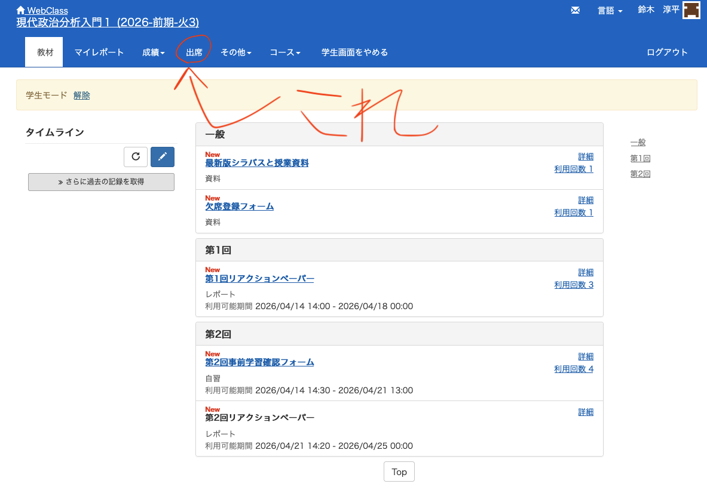
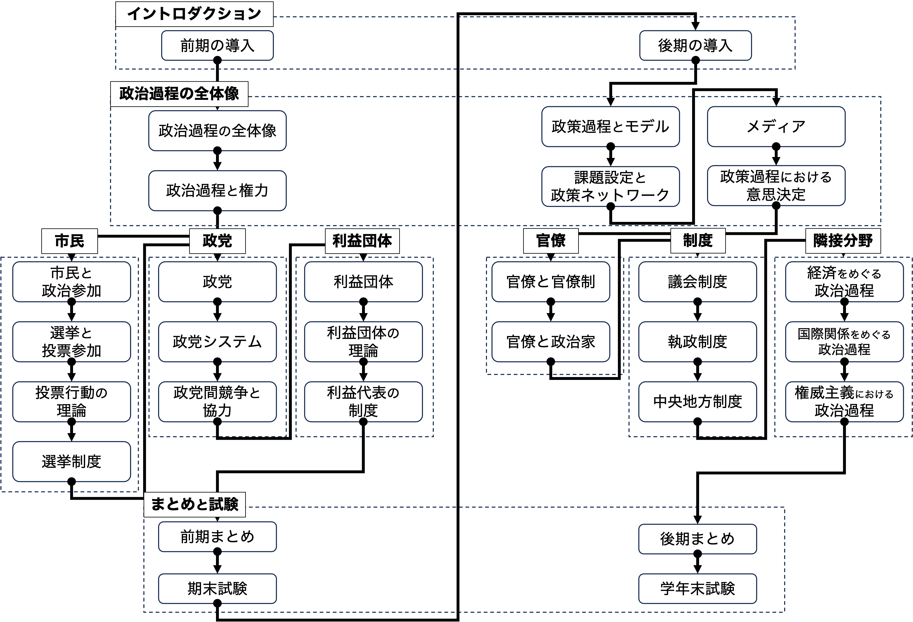
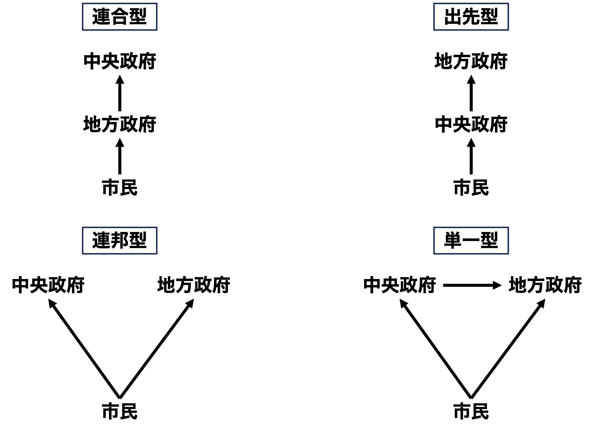
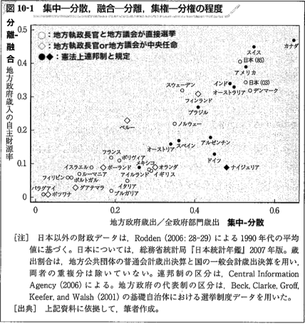

## 出席登録をお願いします

## 今日の目次

1. はじめに
1. 中央地方関係
1. 集権と分権を超えて
1. 足による投票
1. 日本の地方分権改革
1. まとめ

# はじめに
## 先週のRPより
TBD

## 本日の目的と到達目標
#### 目的
中央地方関係を規律する様々な制度を考察する。まずは中央地方関係を分類する理論的な観点を紹介し、各国の制度を国際的に比較する。次に地方自治がもたらす帰結について、「足による投票」という概念を手がかりに検討する。最後に日本の地方制度および90年代に行われた改革を概観し、その妥当性を考察する。

::: {.fragment .fade-in}
#### 到達目標
1. 中央地方関係をプリンシパル・エージェント関係に着目して4つに分類できる。
1. 中央地方関係を集中-分散軸と融合-分離軸と集権-分権軸の3つを用いて分類できる。
1. 「足による投票」という概念とその帰結を説明できる。
1. 90年代に行われた日本の地方分権改革の内容と評価を説明できる。

:::

## 本日の授業の位置付け

# 中央地方関係
## クイズ
中央地方関係の制度は「**単一制**」と「**連邦制**」に大まかに分類されるのが一般的です。それでは以下の国々はどちらに分類されるでしょうか。

1. 日本
1. アメリカ
1. ドイツ
1. イギリス
1. フランス
1. カナダ

[WebClassで回答](https://webclass.komazawa-u.ac.jp/webclass/login.php?id=95f4f53e455af4915a97004d0ff3f758&page=1)

## 中央地方制度
**中央政府**と**地方政府**との関係を規律するさまざまなルールの総体

::: {.fragment .fade-in}
#### 中央政府（central government）
その国全体を統治する政府

:::

::: {.fragment .fade-in}
#### 地方政府（local government）
国の中の特定の地域を統治する政府

::: {.incremental}
- 政策の効率性や政治参加、権力抑制にとって重要
:::
:::

## 一般的な二類型
#### 単一制（unitary system）
中央政府が主権を持ち、地方政府に権限を移譲するシステム

::: {.incremental}
- 例：日本、イギリス、フランス

:::

::: {.fragment .fade-in}
#### 連邦制（federal system）
地方政府が主権を持ち、中央政府に権限を移譲するシステム

::: {.incremental}
- 例：アメリカ、ドイツ、カナダ

:::
:::

## PA関係から見た類型
市民・中央政府・地方政府の委任関係に着目すると4類型

{.r-stretch}

::: {.notes}
市民を究極の本人として、委任関係から中央地方関係を整理するとこの4つ

- **連合型**…市民→地方→中央の単線
  - 例：連合規約時代のアメリカ
- **出先型**…市民→中央→地方の単線
  - 例：大日本帝国、サッチャー改革後のイギリス
- **連邦型**…市民→地方と市民→中央の複線
  - 例：現代のアメリカ
- **単一型**…市民→地方と市民→中央の複線に加えて、中央→地方の関係
  - 例：現代の日本
  
:::

# 集権と分権を超えて
## 質問
日本は伝統的に「中央集権」であると言われ、それが様々な問題を生み出しているからとして「地方分権」を進めるべきだという意見が出されてきていました。

それでは具体的に日本のどういう部分が「中央集権」的だと言えるのでしょうか。

[WebClassチャット](https://webclass.komazawa-u.ac.jp/webclass/login.php?id=2a3ae47237ab022f2f37e6f820dfbe82)

## もう一つの分類
中央・地方の権限配分や業務分担、意思決定の自立性に着目

::: {.fragment .fade-in}
#### 集中-分散
中央に権限が集中していれば集中、地方も権限を持っていれば分権

:::

::: {.fragment .fade-in}
#### 融合-分離
中央と地方で業務に重複があれば融合、別の業務を分担していれば分離

:::

::: {.fragment .fade-in}
#### 集権-分権
地方が中央からの意向に従う必要があれば集権、地方が自律的に意思決定できるなら分権

:::

## 3つの軸を区別する意味
論理的には3つは別の次元

::: {.incremental}
- 地方政府の業務量が大きくても（分散）…
   - 中央から委託を受けているだけかもしれない（融合）
   - 意思決定は中央に従属しているだけかもしれない（集権）
- 中央と地方で同様のことをしていても（融合）…
   - 意思決定を自律的に行えるかもしれない（分権）
   - 地方の業務量は大きいかもしれない（分散）

:::

## データで見る各国の位置
分散的な国は分離的、集中的な国は融合的

{.r-stretch}

::: {.notes}
 データで見る各国の分類（建林ほか2008、p.304）

- 集中-分散…地方政府支出の割合
- 融合-分離…地方歳入中の地方税の割合
- 集権-分権…地方の首長が中央から任命されるか

→全体的には分散・分離・分権と集中・融合・集権が成立していて日本は分散・分離・分権
:::

# 足による投票
## ハーシュマン『離脱・発言・忠誠』
::: {.columns}
::: {.column width=75%}
人々が所属集団に対して不満を感じたときの行動を分析

::: {.incremental}
- 例：従業員、消費者

:::

::: {.fragment .fade-in}
#### 離脱
感じている不満を表出することなく去る
:::

::: {.fragment .fade-in}
#### 発言
感じている不満を表出し、改善を求める

:::

::: {.fragment .fade-in}
#### 忠誠
集団に対する愛着から残留する

:::

:::

::: {.column width=25%}

:::

:::

## クイズ
ある人が自分が住んでいる市区町村の行政サービスに不満を持っていて役所に苦情を申し立てようか悩んでいます。

①すぐ引越しできそうな場合と②できなさそうな場合それぞれでこの人は苦情を申し立てるでしょうか、それとも申し立てないでしょうか。

[WebClassで回答](https://webclass.komazawa-u.ac.jp/webclass/login.php?id=6ff0e7a13085279ad82e133141d19743&page=1)

::: {.notes}
一般に退出が選択肢としてある場合、ない場合と比べて発言は行われにくい
:::

## 足による投票
所属する地方自治体に不満を感じた場合、市民は以下の選択肢を持つ

::: {.incremental}
- 投票によって不満を表出（**発言**）
- 他に住みやすい自治体に引っ越す（**離脱**）

:::

::: {.fragment .fade-in}
一般に国内の他自治体に引っ越すことは海外への引っ越しよりも簡単なので、人々は実際の投票の代わりに引っ越す＝**足による投票**

:::

## 底辺への競争 (race-to-bottom)
自治体の提供する福祉サービスは極小化する

::: {.incremental}
- 手厚い福祉は低所得層を引き寄せる（**福祉による磁石**）
- 財源を賄うための課税は高所得層を遠ざける（**足による投票**）
- 結局財源を賄えないので自治体は福祉を提供できない。

:::

# 日本の地方分権改革
## 質問
前半で学んだ3つの軸（集中－分散、融合－分離、集権－分権）で捉えると、戦後日本の中央地方関係はそれぞれどのように位置づけられるでしょうか。一言理由を添えて書き込んでみてください。

- **集中-分散**…中央に権限が集中してれば集中、地方も権限を持っていれば分権
- **融合-分離**…中央と地方で業務に重複があれば融合、別の業務を分担していれば分離
- **集権-分権**…地方が中央からの意向に従う必要があれば集権、地方が自律的に意思決定できるなら分権

[WebClassチャット](https://webclass.komazawa-u.ac.jp/webclass/login.php?id=2a3ae47237ab022f2f37e6f820dfbe82)

## 分権化改革以前の中央・地方関係
通俗的には中央集権体制と理解

::: {.incremental}
- **3割自治論**…地方財政を見ると日本は3割の自治しかできていない
  - 国税＋地方税のうち、地方税は3割
  - 地方歳出のうち地方税分は3割
- **機関委任事務**…地方自治体が国の下部機関として行う業務
  - 例：パスポート発行、飲食店営業許可、生活保護行政
  - 国の包括的指揮権が認められ、条例も制定できず、怠慢の際には知事解任権も

:::

## 地方分権改革
90年代以降、中央集権から地方分権へと移行する改革が実施

::: {.incremental}
- 地方自治法改正（1991年）…知事解任権の廃止
- **地方分権一括法**（2000年）…国と地方の関係を「対等」に
  - **機関委任事務**の廃止と**法定受託事務**の新設
    - 国の包括的指揮権の廃止と自治体の条例制定権の導入
- **三位一体の改革**（2004-07年）…財政面での地方分権
  - 地方交付税交付金・国庫負担金の削減
  - 基幹税目の税源移譲
    - 所得税＋住民税のうち、後者の配分を大きく

::: 

## 分権改革を考える
日本はそもそも単純な「中央集権国家」ではない

::: {.incremental}
- データで見れば**分散・分離・分権型**
- 3割自治論の薄弱さ
  - 全税収のうち地方税3割は国際的には多い
  - 地方の仕事を全て地方で賄うことが良いことが疑問
    - 例：自前でゴミ処理しかしない自治体
- **マーブルケーキ**モデル…中央と地方は主従ではなく相互作用
  - **革新自治体**…福祉政策や公害対策を先行して行い、中央が採用

:::

# まとめ
## 本日の目的と到達目標
#### 目的
中央地方関係を規律する様々な制度を考察する。まずは中央地方関係を分類する理論的な観点を紹介し、各国の制度を国際的に比較する。次に地方自治がもたらす帰結について、「足による投票」という概念を手がかりに検討する。最後に日本の地方制度および90年代に行われた改革を概観し、その妥当性を考察する。

::: {.fragment .fade-in}
#### 到達目標
1. 中央地方関係をプリンシパル・エージェント関係に着目して4つに分類できる。
1. 中央地方関係を集中-分散軸と融合-分離軸と集権-分権軸の3つを用いて分類できる。
1. 「足による投票」という概念とその帰結を説明できる。
1. 90年代に行われた日本の地方分権改革の内容と評価を説明できる。

:::

## 次回までに
#### 事後学習

 - 授業資料を見直し、目標到達をセルフチェック
 - WebClass上でのリアクションペーパー入力（日曜日まで）
    - 今回のみ、多数決型とコンセンサス型について追加問題
 
#### 事前学習

 - 【事前】教科書（XIII-1〜7）を読む。
